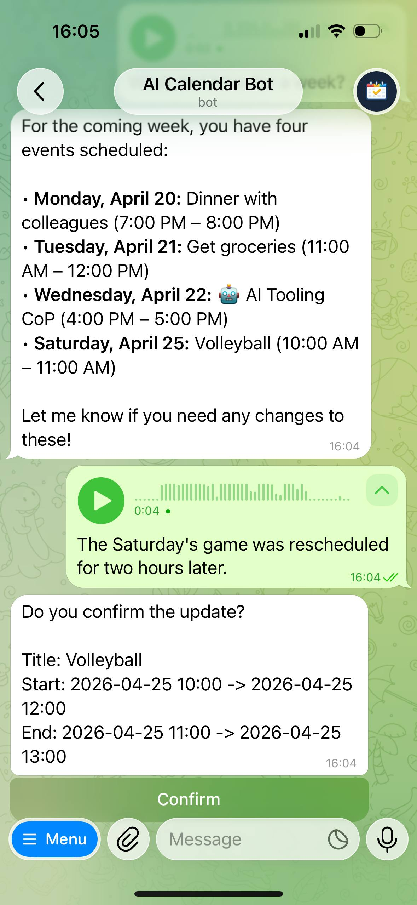
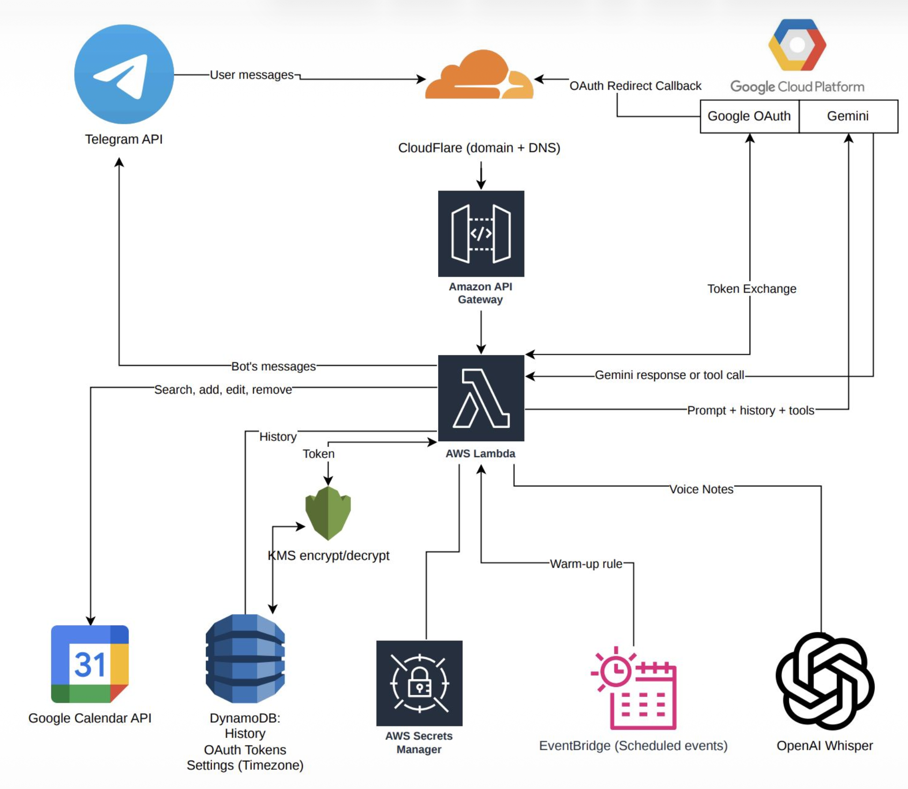

# AI Google Calendar Assistant in Telegram

Telegram bot that manages Google Calendar with natural language and voice input.

## What It Does

- Connects a user Google account via OAuth (`/connect`)
- Creates events from natural language
- Finds events by date range or title
- Edits/removes events with confirmation previews
- Supports voice notes (up to 2 minutes)
- Disconnects Google access (`/disconnect`)
- Shows legal docs (`/docs`)

## High-Level Architecture

- Telegram webhook -> Cloudflare domain -> API Gateway -> AWS Lambda
- Lambda orchestrates:
  - Gemini tool-calling flow
  - Google Calendar API operations
  - OpenAI Whisper transcription for voice notes
- Data and secrets:
  - DynamoDB for chat history, drafts, OAuth data
- KMS for OAuth token encryption/decryption
- AWS Secrets Manager for app secrets

## AI Integration Model

- LLM receives a strict system prompt and a bounded set of tools
- Backend remains the source of truth and executes all side effects
- Gemini explicit context caching is used for static context to reduce repeated prompt tokens.
- Typical flow:
  1. Patch/create draft
  2. Lookup candidate events
  3. Build preview
  4. Confirm
  5. Execute in backend
- Guardrails:
  - max tool calls per turn
  - invalid tool output repair loop
  - explicit confirmation before destructive actions
